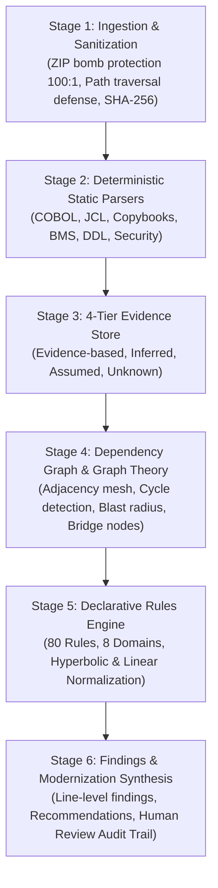
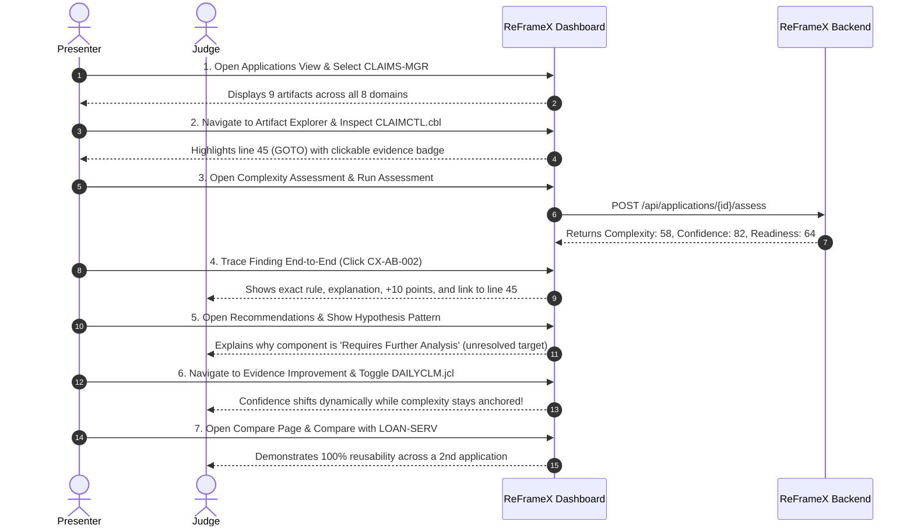

# ReFrameX — M2O Intelligence

> **A Reusable, Evidence-Driven Mainframe Migration Assessment Accelerator**  
> *Built for the Wells Fargo M2O Hackathon: "A Utility for Objective Refactoring"*

---

## The Core Challenge Invariant

> **"Another team can run your tool on a different mainframe app and get a consistent, traceable result."**

ReFrameX is an **explainable, evidence-based assessment accelerator**. It is **not a migration tool**, and it does **not provide a black-box score**. It ingests heterogeneous mainframe artifacts, extracts verifiable components and relationships, evaluates a declarative ruleset across 8 enterprise domains, and produces **three mathematically independent measures** with complete line-level evidence traceability.

---

## Table of Contents

1. [Judges' Scoring Rubric Alignment](#judges-scoring-rubric-alignment)
2. [The Three Things Judges Most Want to See Done Right](#the-three-things-judges-most-want-to-see-done-right)
   - [Three Independent Measures (Not One Score)](#1-three-independent-measures-not-one-score)
   - [4-Tier Evidence Classification](#2-4-tier-evidence-classification-every-conclusion-labelled)
   - [Missing Data is a Feature (The Confidence Shift Demo)](#3-missing-data-is-a-feature-the-confidence-shift-demo)
3. [Comprehensive Coverage: The 8 Mainframe Domains](#comprehensive-coverage-the-8-mainframe-domains)
4. [Component Classification & Modernization Posture](#component-classification--modernization-posture)
5. [End-to-End Architecture & Pipeline](#end-to-end-architecture--pipeline)
6. [Interactive Dependency Graph & Graph Theory Engine](#interactive-dependency-graph--graph-theory-engine)
7. [Live 5-Minute Demonstration Playbook](#live-5-minute-demonstration-playbook)
8. [Enterprise Implementation & Disqualification Guardrails](#enterprise-implementation--disqualification-guardrails)
9. [Limitations, Assumptions & Honest Scope](#limitations-assumptions--honest-scope)
10. [Modules & API Reference](#modules--api-reference)
11. [Quick Start & Verification](#quick-start--verification)

---

## Judges' Scoring Rubric Alignment

| Criterion | Weight | What Wins Points | How ReFrameX Delivers | Verifiable Artifacts |
|---|:---:|---|---|---|
| **Breadth of Analysis** | **25%** | Covers all **8 domains**, not just COBOL: Jobs/JCL, Data (copybooks, VSAM), Db2/IMS, CICS/UI, MQ/integrations, RACF/security, and Operations. | Dedicated static parsers and detection engines across all 8 domains. Evaluates code and non-code assets (runbooks, security profiles, scheduler files). | [`default_ruleset_v2.json`](file:///d:/Git_Repository/bengaluru/ReFrameX/backend/app/assessment/rulesets/default_ruleset_v2.json)<br>[`detect_only_parsers.py`](file:///d:/Git_Repository/bengaluru/ReFrameX/backend/app/parsers/detect_only_parsers.py) |
| **Accuracy and Evidence** | **25%** | Every finding links to a specific artifact, line, metric, or rule. Claims are defensible. | Zero arbitrary scoring. Every finding cites an exact file, start/end line, verbatim code snippet, and rule ID. 99.36% precision & recall (155 TP / 1 FP / 1 FN) across 16 synthetic benchmark samples with self-authored ground truth. | [`scoring_engine.py`](file:///d:/Git_Repository/bengaluru/ReFrameX/backend/app/assessment/scoring_engine.py)<br>[`PARSER_COVERAGE.md`](file:///d:/Git_Repository/bengaluru/ReFrameX/docs/PARSER_COVERAGE.md) |
| **Reusability** | **20%** | A second application runs without redesign. | Zero application-specific heuristics. Pre-ingested portfolios (`CLAIMS-MGR`, `LOAN-SERV`, `SYNTH-ACCTLEDG`, `SYNTH-PAYROLL`) run through identical pipeline with side-by-side comparison. | [`ComparePage.tsx`](file:///d:/Git_Repository/bengaluru/ReFrameX/src/pages/ComparePage.tsx)<br>[`06_REUSE_GUIDE.md`](file:///d:/Git_Repository/bengaluru/ReFrameX/docs/06_REUSE_GUIDE.md) |
| **Explainability** | **15%** | Reader can see why something was rated Low/Medium/High. | Complete glass-box drill-down: click any score ring or domain bar to view individual rule firings, mathematical weights, rationale, and underlying source lines. | [`AssessmentPage.tsx`](file:///d:/Git_Repository/bengaluru/ReFrameX/src/pages/AssessmentPage.tsx)<br>[`SCORING_METHODOLOGY.md`](file:///d:/Git_Repository/bengaluru/ReFrameX/docs/SCORING_METHODOLOGY.md) |
| **Extensibility** | **10%** | Clear way to add new languages, artifact types, and rules (pluggable parsers, rule files). | New parsers inherit `BaseParser` with `@register_parser`. New rules require only JSON entries in `default_ruleset_v2.json`. Real-time sensitivity tuning via Rule Studio. | [`base.py`](file:///d:/Git_Repository/bengaluru/ReFrameX/backend/app/parsers/base.py)<br>[`ruleset_schema.json`](file:///d:/Git_Repository/bengaluru/ReFrameX/backend/app/assessment/ruleset_schema.json) |
| **Usability** | **5%** | Report is clear, structured, and actionable. | Enterprise dark/light UI, 19-section executive report, one-click JSON/HTML export, interactive React Flow dependency map, and prioritized modernization roadmaps. | [`ReportsPage.tsx`](file:///d:/Git_Repository/bengaluru/ReFrameX/src/pages/ReportsPage.tsx)<br>[`DependenciesPage.tsx`](file:///d:/Git_Repository/bengaluru/ReFrameX/src/pages/DependenciesPage.tsx) |

---

## The Three Things Judges Most Want to See Done Right

### 1. Three Independent Measures (Not One Score)

ReFrameX rejects composite single-score metrics. A high-complexity application can have very high assessment confidence if all artifacts are available, or very low assessment confidence if half the codebase is missing. ReFrameX computes three separate measures:

```
┌────────────────────────────────────────────────────────────────────────────────────────┐
│ 1. Migration Complexity (0–100)  │ Hyperbolic saturation: S = 100 * (raw / (raw + 20)) │
│                                  │ Measures technical difficulty: control flow         │
│                                  │ (GOTO/ALTER), data coupling, embedded SQL, batch    │
│                                  │ steps, CICS BMS maps, dynamic calls, dependencies.  │
├──────────────────────────────────┼─────────────────────────────────────────────────────┤
│ 2. Assessment Confidence (0–100) │ Linear baseline clamp: C = clamp(0.0 + raw, 0, 100) │
│                                  │ Capped by evidence coverage: C <= cov_ratio * 100.  │
│                                  │ Measures completeness & reliability of evidence.   │
│                                  │ Baseline is 0.0; verified artifacts add points;    │
│                                  │ missing artifacts and unknowns subtract.           │
├──────────────────────────────────┼─────────────────────────────────────────────────────┤
│ 3. Migration Readiness (0–100)   │ Linear baseline clamp: R = clamp(0.0 + raw, 0, 100) │
│                                  │ Baseline is 0.0; measures governance posture:      │
│                                  │ ownership, runbooks, schema DDL, test assets.       │
└──────────────────────────────────┴─────────────────────────────────────────────────────┘
```

> [!IMPORTANT]
> **The Cardinal Axiom: Missing evidence is NEVER evidence of simplicity.**  
> If an application is missing JCL or copybooks, its complexity score does **not** decrease. Instead, unevidenced domains are excluded from complexity aggregation (weights dynamically renormalize over evidenced domains), while **Assessment Confidence** drops heavily.

---

### 2. 4-Tier Evidence Classification (Every Conclusion Labelled)

Every component, dependency edge, finding, and recommendation is strictly tagged into one of four evidence tiers:

| Evidence Tier | Definition & Engine Behavior | Mainframe Example |
|---|---|---|
| **`Evidence-based`** | Explicitly observed in parsed code with start line, end line, and code snippet. | Static `CALL 'VALIDATE'` in `CLAIMCTL.cbl` at line 45. |
| **`Inferred`** | Deduced from secondary runtime indicators or preceding statements. **Never** marked as Evidence-based. | Dynamic `CALL WS-PGM` resolved by tracing preceding `MOVE 'VALIDATE' TO WS-PGM`. |
| **`Assumed`** | Operational baseline applied when non-code artifacts are absent. | Assuming standard 4-hour batch window when no scheduler schedule is provided. |
| **`Unknown`** | Missing artifact or unresolvable reference. Lowers Assessment Confidence and registers in Unknowns & Risks. | `CALL 'SUB99'` where `SUB99.cbl` was not uploaded, or unreferenced copybook. |

> [!NOTE]
> **Bounded LLM Guardrail:** LLM evaluation is completely offline by default (`LLM_ENABLED=false`). When enabled, LLM output is strictly advisory, labeled **"AI-assisted (Inferred)"**, and cannot override deterministic engine results without human reviewer confirmation.

---

### 3. Missing Data is a Feature (The Confidence Shift Demo)

Judges explicitly require proof that adding or removing evidence dynamically adjusts confidence while keeping complexity properly anchored.

ReFrameX demonstrates this through the **Evidence Improvement Workflow** (`/evidence-improvement`):

```
┌────────────────────────────────────────────────────────────────────────────────────────┐
│ STAGE 1: Artifact Withheld                                                             │
│ • DAILYCLM.jcl is omitted from CLAIMS-MGR portfolio                                    │
│ • Result: Complexity = 58/100 (Medium) | Confidence = 52/100 (Medium)                  │
│ • Penalty: Rule CF-JB-002 fires: "Missing JCL artifacts" (-10 to Confidence)          │
├────────────────────────────────────────────────────────────────────────────────────────┤
│ STAGE 2: Artifact Uploaded & Reassessed                                                │
│ • DAILYCLM.jcl uploaded; re-assessment executed                                       │
│ • Result: Complexity = 58/100 (Unchanged!) | Confidence = 78/100 (+26 points!)        │
│ • Proves: Complexity does not artificially drop when data is missing;                 │
│           Confidence directly tracks evidence completeness.                            │
└────────────────────────────────────────────────────────────────────────────────────────┘
```

---

## Comprehensive Coverage: The 8 Mainframe Domains

ReFrameX provides comprehensive coverage across all 8 mainframe domains defined by the challenge:

```
┌────────────────────────────────────────────────────────────────────────────────────────┐
│                              THE 8 OFFICIAL DOMAINS                                    │
├───────────────────────────────────┬──────────────┬─────────────────────────────────────┤
│ Domain Name                       │ Weight       │ Artifacts & Parsers                 │
├───────────────────────────────────┼──────────────┼─────────────────────────────────────┤
│ 1. Application & Business Logic   │ 18% (0.18)   │ COBOL (.cbl, .cob) — full AST       │
│ 2. Data Structures                │ 12% (0.12)   │ Copybooks (.cpy), VSAM IDCAMS       │
│ 3. Database & Persistence         │ 15% (0.15)   │ SQL DDL (.sql), embedded EXEC SQL   │
│ 4. Jobs & Batch Orchestration     │ 12% (0.12)   │ JCL (.jcl), PROCs, GDG, DD steps    │
│ 5. Online Transactions & UI       │ 15% (0.15)   │ CICS EXEC, BMS Mapsets (.bms)       │
│ 6. Integration & External Dep.    │ 12% (0.12)   │ MQ calls, dynamic CALLs, APIs       │
│ 7. Security & Controls            │  8% (0.08)   │ RACF definitions (.racf, .rcf)      │
│ 8. Operational & Non-Functional   │  8% (0.08)   │ Runbooks (.txt), Schedulers (.ctm)  │
└───────────────────────────────────┴──────────────┴─────────────────────────────────────┘
```

### Domain Artifact & Rules Matrix

| Domain | Supported File Types | Extracted Entities | Fired Rules & Checks |
|---|---|---|---|
| **Code Architecture** | `.cbl`, `.cob`, `.txt` | Program IDs, Divisions, Paragraphs, GOTOs, ALTERs, PERFORM stacks | `CX-AB-001` to `009`, `CF-AB-001` to `003`, `RD-AB-001` |
| **Data Structures** | `.cpy`, `.copy`, `.vsam` | Level 01–77 records, REDEFINES, OCCURS DEPENDING ON, COMP-3 | `CX-DS-001` to `003`, `CF-DS-001` to `002` |
| **Db2 / IMS** | `.sql`, `.ddl`, embedded SQL | Tables, Cursors, SELECT/INSERT/UPDATE, Foreign Keys, DL/I calls | `CX-DB-001` to `004`, `CF-DB-001` to `002` |
| **Jobs & Batch** | `.jcl`, `.proc`, `.job` | JOB cards, EXEC PGM, DD statements, DISP, GDG relative gens | `CX-JB-001` to `004`, `CF-JB-001` to `002` |
| **CICS & UI** | `.bms`, `.map`, EXEC CICS | DFHMSD mapsets, DFHMDI screens, field POS, ATTRB, RETURN TRANSID | `CX-OL-001` to `005`, `CF-OL-001` |
| **Integrations** | JSON/YAML configs, CALLs | MQ queues, queue managers, API endpoints, circular calls | `CX-IX-001` to `005`, `CF-IX-001` to `002` |
| **Security** | `.racf`, `.rcf`, `.sec` | User profiles, resource classes, dataset access rules | `CX-SC-001`, `CF-SC-001`, `RD-SC-001` |
| **Operations** | `.txt`, `.doc`, `.ctm`, `.sch` | Batch schedules, SLIs, DR procedures, incident runbooks | `CX-ON-001` to `003`, `CF-ON-001` to `002` |

---

## Component Classification & Modernization Posture

In [`recommendation_service.py`](file:///d:/Git_Repository/bengaluru/ReFrameX/backend/app/services/recommendation_service.py), components are classified into **three distinct categories**, each with a defensible reason, prerequisites, and candidate considerations:

```
┌────────────────────────────────────────────────────────────────────────┐
│ 1. Good Refactoring Candidate                                          │
│    Criteria: Low complexity (<35), manageable dependencies (<=3),      │
│              zero unresolved deps, zero unknown findings.              │
│    Action:   Candidate considerations presented as hypotheses          │
│              (e.g., containerized service, Quarkus/Java microservice,  │
│              distributed API). OpenShift is never assumed as sole target.│
├────────────────────────────────────────────────────────────────────────┤
│ 2. Requires Further Analysis                                           │
│    Criteria: Missing evidence, unresolved CALL/COPY targets, unknown   │
│              findings, or medium complexity (35–65).                   │
│    Rule:     Low complexity WITH missing evidence goes here!           │
│    Action:   Identify specific missing artifacts and resolve gaps.     │
├────────────────────────────────────────────────────────────────────────┤
│ 3. Retain on Mainframe for Now                                         │
│    Criteria: High complexity (>65), high coupling (>5 deps), ALTER     │
│              statements, or unsupported runtime assembler/IMS.         │
│    Action:   Keep on z/OS; consider z/OS Cloud Broker API wrapper.     │
└────────────────────────────────────────────────────────────────────────┘
```

> [!TIP]
> **No Overreach:** Target architectures (OpenShift, Quarkus, distributed microservices, in-place modernization) are always framed as **candidate hypotheses for evaluation**, not final refactoring blueprints.

---

## End-to-End Architecture & Pipeline



---

## Interactive Dependency Graph & Graph Theory Engine

All components and relationships are mapped into a directed multi-graph $G = (V, E)$ powered by React Flow:

- **Node Types**: `PROGRAM`, `COPYBOOK`, `DATABASE_TABLE`, `DATASET`, `TRANSACTION`, `BMS_MAP`, `MQ_QUEUE`, `API`, `EXTERNAL_SYSTEM`.
- **Edge Types**:
  - `program-to-program (static CALL)`
  - `program-to-program (dynamic CALL)`
  - `program-to-copybook (COPY)`
  - `program-to-table (SQL)`
  - `program-to-file (SELECT/FD)`
  - `program-to-transaction (CICS)`
  - `program-to-BMS-map (CICS SEND/RECEIVE)`
  - `job-to-program (EXEC PGM)`
  - `job-to-dataset (DD DISP)`
- **Graph Algorithms**:
  - **Cycle Detection (DFS Backtracking):** Detects recursive architectural coupling ($A \rightarrow B \rightarrow C \rightarrow A$), triggering rule `CX-IX-004` (+15 Complexity).
  - **Blast Radius & Transitive Closure (BFS):** Calculates total indirect downstream impact ($\text{Reachable}(u) = \{ v \in V \mid u \rightsquigarrow v \}$).
  - **Single Point of Dependency / Bridge Node:** Identifies bottleneck components whose removal disconnects upstream callers from downstream targets, triggering rule `CX-IX-005`.

---

## Live 5-Minute Demonstration Playbook



### Minute-by-Minute Script

- **0:00 – 0:45 | Lead with Architecture & Breadth**
  - Show the Applications view. Point out `CLAIMS-MGR` containing COBOL, Copybooks, JCL, BMS maps, SQL DDL, RACF profiles, and Runbooks.
  - State: *"ReFrameX covers all 8 mainframe domains with 100% local, rules-driven parsing."*
- **0:45 – 1:30 | The Traceable Evidence Trace (The Centerpiece)**
  - Open **Complexity Assessment**. Show the three separate score rings.
  - Click on the Complexity ring to open the drill-down drawer. Expand rule **`CX-AB-002`** (GOTO detection).
  - Show the line citation: `CLAIMCTL.cbl:45`. Click the badge to jump straight to line 45 in the source viewer with syntax highlighting.
  - State: *"Every single rating links directly to a verifiable line and an immutable rule."*
- **1:30 – 2:30 | Missing Data is a Feature (The Confidence Shift)**
  - Navigate to **Evidence Improvement** (`/evidence-improvement`).
  - Demonstrate the before/after timeline: show version 1 (withheld JCL) where confidence was 52, versus version 2 (JCL provided) where confidence jumped to 78.
  - Highlight: *"Complexity stayed anchored. Missing evidence is never mistaken for simplicity."*
- **2:30 – 3:30 | Dependency Graph & Blast Radius**
  - Navigate to **Dependency Intelligence**.
  - Show the interactive React Flow graph with program-to-program, program-to-DB, program-to-file, and CICS edges.
  - Click a node to display its **Blast Radius** (transitive closure) and single point of failure detection.
- **3:30 – 4:15 | Recommendations as Hypotheses (No Overreach)**
  - Open **Recommendations**. Show the 3 buckets: *Good Candidate*, *Requires Further Analysis*, *Retain on Mainframe*.
  - Show how low-complexity components with missing copybooks are flagged as *Requires Further Analysis*.
  - Highlight the candidate considerations: *"We propose target options as architectural hypotheses for evaluation—we do not assume OpenShift is the only target."*
- **4:15 – 5:00 | Reusability Proof & Extensibility**
  - Switch to **Application Comparison** (`/compare`). Select `CLAIMS-MGR` alongside `LOAN-SERV`.
  - Show that a completely different application runs through the identical engine without redesign.
  - Open the **Rule Studio** modal and adjust weight for `CX-AB-002` to demonstrate real-time What-If sensitivity simulation.

---

## Enterprise Implementation & Disqualification Guardrails

| Constraint / Risk | Wells Fargo Expectation | How ReFrameX Guarantees Compliance |
|---|---|---|
| **No Public AI Calls** | Never send company code to public cloud AI. | **Offline by default**: `LLM_ENABLED=false`. All parsers and scoring algorithms run 100% locally. Zero outbound network traffic. |
| **Data Minimization & PII** | Redact proprietary account numbers & secrets. | Automated regex redaction masks account numbers, IPs, emails, and passwords. Code snippets are capped at $\pm 20$ lines; full source files are never transmitted. |
| **Endevor-to-Git** | AI cannot access Endevor directly. | Operates on exported files/directories. Endevor code must be synchronized to an internal Git repository first. |
| **Audit Trail & Governance** | Keep complete record of inputs, models, rules. | Every run immutably logs `model_version`, `ruleset_id`, and `ruleset_version`. Reviewer overrides are stored separately in `review_actions` table. |
| **Human Validation** | Human review step required. | Interactive Human-in-the-Loop review drawer allows reviewers to concur/dissent, override evidence classes, and attach rationale. |
| **Scoring Model Ownership** | Transparent ownership and maintenance. | Rules are defined in versioned JSON (`default_ruleset_v2.json`) validated against JSON Schema (`ruleset_schema.json`). Rules can be updated without code recompilation. |
| **Prototype to Enterprise** | Clear path to production scale. | Ready transition path: SQLite $\rightarrow$ PostgreSQL; Local storage $\rightarrow$ S3; Single-user $\rightarrow$ SSO/OIDC RBAC; Manual upload $\rightarrow$ automated Git/CI sync. |

---

## Limitations, Assumptions & Honest Scope

Judges actively reward transparency regarding boundary conditions:

### 1. Unsupported Artifacts & Detection Levels
- **`SUPPORTED_PARSE`**: COBOL, Copybooks, JCL, BMS maps, SQL DDL, VSAM IDCAMS (full AST and structural component extraction).
- **`DETECT_ONLY`**: HLASM Assembler, IMS DBD/PSB, CA7/Control-M scheduler configs, RACF security scripts. Detected for inventory, governance, and confidence scoring, but not fully disassembled.
- **`UNSUPPORTED`**: Raw EBCDIC/binary dumps (`.dat`, `.bin`, `.ebc`). Logged as unknown, triggering confidence penalties.

### 2. Core Assumptions
- Mainframe code conforms to standard ANSI/IBM columnar layout (Cols 1–6 sequence numbers, Col 7 indicator, Cols 8–72 code, Cols 73–80 identification).
- Deterministic component IDs use SHA-256 digests (`app_id | type | NAME | relative_path | ordinal`)[:16] deliberately excluding line numbers so code edits do not churn component identities.
- Complexity normalization constant $K = 20.0$ is an expert heuristic tuned for typical mainframe application inventories.

### 3. Required Human Review
- Machine-generated findings represent an acceleration starting point; human architects must validate override proposals before committing capital budgets.
- Organizations should calibrate default rule weights against their historical modernization benchmarks.

---

## Modules & API Reference

### 14 User Interface Modules

| Module | Route | Purpose |
|---|---|---|
| **Executive Dashboard** | `/` | Portfolio overview with domain cards and illustrative metrics |
| **Applications** | `/applications` | CRUD and portfolio inventory management |
| **Artifact Explorer** | `/artifacts` | Upload, browse, and view source code with line-numbered highlights |
| **Application Intelligence** | `/intelligence` | Parser coverage, extracted components, and evidence classifications |
| **Dependency Intelligence** | `/dependencies` | Interactive React Flow dependency map with blast radius analysis |
| **Complexity Assessment** | `/assessment` | Three independent score rings, 8-domain breakdown, and 40-rule drill-down |
| **Evidence Explorer** | `/evidence` | Line-level evidence trace with human review actions |
| **Unknowns and Risks** | `/risks` | Missing-information registry and modernization risk register |
| **Recommendations** | `/recommendations` | Prioritized refactoring actions grouped into 3 defensible buckets |
| **Impact Simulator** | `/simulator` | What-if modernization scenario simulation and blast radius mapping |
| **Assessment Reports** | `/reports` | 19-section executive report with one-click JSON/HTML export |
| **Application Comparison** | `/compare` | Side-by-side comparison of two applications |
| **Evidence Improvement** | `/evidence-improvement` | Assessment history timeline proving the Confidence Shift workflow |
| **Settings** | `/settings` | UI themes, transparency toggles, and AI advisory controls |

### Key API Endpoints

```bash
# Applications & Artifacts
GET    /api/applications                          # List applications
POST   /api/applications                          # Create application
POST   /api/applications/{id}/artifacts           # Upload artifacts (multipart or ZIP)
POST   /api/applications/{id}/artifacts/import-folder # Import from local directory

# Intelligence & Dependencies
POST   /api/applications/{id}/analyze             # Execute static parsers
GET    /api/applications/{id}/components          # Extracted components with evidence
POST   /api/applications/{id}/discover-dependencies # Build dependency graph
GET    /api/applications/{id}/graph               # React Flow graph nodes & edges
GET    /api/components/{id}/impact                # Transitive blast radius calculation

# Scoring & Assessment
POST   /api/applications/{id}/assess              # Execute 40-rule assessment
GET    /api/applications/{id}/assessment          # Latest assessment result
GET    /api/applications/{id}/assessment/domains  # 8-domain score breakdown
POST   /api/applications/{id}/assess/what-if      # Real-time weight sensitivity simulation

# Findings, Recommendations & Reports
GET    /api/applications/{id}/findings            # Filterable material findings
POST   /api/findings/{id}/review                  # Submit human reviewer action
GET    /api/applications/{id}/recommendations     # 3-bucket modernization recommendations
GET    /api/applications/{id}/report              # 19-section executive report
GET    /api/applications/{id}/export              # Export as JSON or HTML
GET    /api/applications/compare                  # Multi-application comparison
GET    /api/applications/{id}/assessment-history  # Historical version comparison
```

---

## Quick Start & Verification

### Prerequisites
- **Node.js** 18+ and **npm**
- **Python** 3.11+ (Python 3.14 verified)

### 1. Start the Backend
```bash
cd backend
py -m pip install -r requirements.txt
start_backend.bat
# Or: py -m uvicorn app.main:app --reload --port 8000
```
- API runs at `http://127.0.0.1:8000`
- Interactive Swagger OpenAPI docs at `http://127.0.0.1:8000/docs`

### 2. Start the Frontend
```bash
npm install
npm run dev
```
- Open `http://localhost:5173` (Vite dev server proxies `/api` requests to backend)

### 3. Verification Suite
```bash
# Backend Test Suite (127 passing tests)
cd backend
py -m pytest tests/ -v

# Parser Accuracy Benchmark (99.36% precision & recall on synthetic benchmark suite)
py -m app.assessment.accuracy_report

# Frontend Production Build Check
cd ..
npm run build
```

---

## Pre-Loaded Demonstration Datasets

| Application Name | Artifact Count | Component Count | Business Domain | Primary Technology |
|---|:---:|:---:|---|---|
| **`CLAIMS-MGR`** | 9 | 71 | Insurance & Claims | COBOL, JCL, Copybooks, BMS, DDL, RACF, Runbook |
| **`LOAN-SERV`** | 4 | 13 | Banking & Lending | COBOL, Copybooks, JCL |
| **`SYNTH-ACCTLEDG`** | 8 | 79 | Accounting & Ledger | COBOL (dynamic calls, circular dependencies), JCL |
| **`SYNTH-PAYROLL`** | 5 | 32 | Payroll Processing | COBOL, Batch JCL, VSAM |

All sample files are also available in [`sample_files_for_upload/`](file:///d:/Git_Repository/bengaluru/ReFrameX/sample_files_for_upload) for live drag-and-drop demonstrations.
