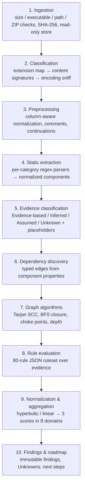

# ReFrameX — Static Analysis Algorithms & Migration-Readiness Computation

> **Scope of this document.** Everything here describes what the ReFrameX backend actually
> does to an uploaded file set, and exactly how the **Migration Readiness** number is produced.
> All statements are grounded in the current code under `backend/app/` (not marketing copy).
> Line/record numbers are always preserved from the original artifact so every number can be traced.
>
> **One-line summary.** ReFrameX performs *deterministic, regex/rule-based static extraction*
> (no compiler, no runtime, no semantic data-flow analysis) over mainframe artifacts, builds a
> typed component graph, evaluates an external JSON rule set over that evidence, and normalizes
> the fired rule weights into three independent 0–100 measures: **Complexity**, **Confidence**
> and **Readiness**. Readiness is the measure of *how well-evidenced and governable* the
> application is for detailed migration planning — not how hard it is to migrate.

---

## 1. Design Principles That Shape Every Algorithm

1. **Deterministic.** Same artifacts + same ruleset version ⇒ same components, same graph, same scores.
   No randomness, no timestamps inside identifiers, no LLM in the scoring path.
2. **Evidence or it did not happen.** Every component, dependency and finding carries an evidence
   class and (where available) `artifact_id`, `line_start`, `line_end`, `snippet`, `rule`.
3. **Missing evidence is never evidence of simplicity.** An unevidenced domain is *not assessed*,
   not scored as "low risk". Only Confidence is penalized for missing evidence.
4. **Never crash, never silently drop.** Unresolved `CALL`/`COPY` targets become explicit
   `Unknown` placeholder components; unparsable artifacts are recorded as `UNSUPPORTED`.
5. **Three measures, never merged.** Complexity, Confidence and Readiness use disjoint rule
   subsets and different normalization functions. Readiness is never derived from Complexity.
6. **Idempotent re-analysis.** Stable SHA-256-derived IDs mean re-uploading the same code
   produces zero database churn.

---

## 2. End-to-End Pipeline



Trigger points (API / seed): `POST /api/applications/{id}/analyze` → `analysis_service.analyze_application`
→ `POST /api/applications/{id}/discover-dependencies` → `POST .../assess` →
`finding_service.rebuild_findings`. Re-running any stage is safe (delete-then-rebuild).

---

## 3. Stage 1 — Ingestion & Security (`services/artifact_service.py`, `services/security.py`)

| Check | Algorithm / rule |
|---|---|
| Per-file size | `len(data) > settings.max_file_size` → reject. `MAX_FILE_SIZE = 20 MB`. |
| Total request size | `MAX_TOTAL_UPLOAD = 200 MB`. |
| Zip file size | `> max_file_size * 5` → reject. |
| Executable by extension | Rejected set: `.exe .dll .so .bat .cmd .sh .msi .jar .com .scr .ps1 .app`. |
| Executable by magic bytes | Prefix match against `MZ`, `\x7fELF`, `\xCAFEBABE` (Java/Mach-O fat), `FEEDFACE`/`FEEDFACF`/`CEFAEDFE` (Mach-O). |
| Path traversal | `safe_relative_path()`: normalize `\`→`/`, reject NUL bytes, absolute paths, drive letters, any `..` segment, collapse `.`/empty segments. |
| ZIP bomb — count | `ZIP_MAX_FILES = 500` entries. |
| ZIP bomb — volume | `ZIP_MAX_TOTAL_UNCOMPRESSED = 300 MB` summed `file_size`. |
| ZIP bomb — ratio | Per entry `file_size / compress_size > 100` → reject. |
| ZIP nesting | Filename slash depth `> ZIP_MAX_NESTING (8)` → reject. |
| Symlinks | Imported in folder mode are skipped; `check_symlink()` rejects links resolving outside the upload root. |
| Storage | Content written under a random 16-hex filename inside `uploads/{application_id}/`, then `chmod 0o444` (read-only). Original name/path kept only in DB. |
| Identity | `sha256(data).hexdigest()` stored on the artifact; used for dedupe/audit. |

**Encoding sniff** (`_detect_encoding`, classifier) — a 4-way decision, not a decoder guess:

1. Bytes decode as `utf-8` **and** as `ascii` → `ASCII (heuristic)`.
2. Bytes decode as `utf-8` only → `UTF-8 (heuristic)`.
3. Else decode `cp037`; compute printable-char ratio; if `ratio ≥ 0.70` **and** any EBCDIC keyword
   (`identification division`, `//job`, `dfhmsd`, `define cluster`, `create table`) is present
   → `EBCDIC (heuristic, cp037)`.
4. Otherwise → `binary/unknown encoding (heuristic)`.

Consequences: a non-decodable artifact is forced to `DETECT_ONLY` support level. An EBCDIC artifact
is *parsed from a decoded cp037 view* (`analysis_service`) while the raw bytes stay untouched on
disk, and **all components extracted from it are downgraded to `Inferred`** with a warning
"Extracted from EBCDIC (cp037) encoded artifact".

Additional fixed-record heuristic: if the first ≤20 lines all have identical length and there are
≥3 lines, `fixed_record_length_hint` is set to that length.

---

## 4. Stage 2 — Artifact Classification (`parsers/classifier.py`)

Two-tier classifier, first match wins:

**Tier 1 — extension map** (~44 extensions). Category → support level:

| Support level | Meaning | Extensions (examples) |
|---|---|---|
| `SUPPORTED_PARSE` | full static extraction | `.cbl .cob .cobol` → COBOL; `.cpy .copy` → Copybook; `.jcl .proc .prc .cntl` → JCL; `.sql .ddl .db2` → SQL; `.bms .map` → BMS; `.asm .mac` → HLASM; `.idcams .vsam .def` → VSAM |
| `DETECT_ONLY` | detected + flagged, no deep extraction | `.psb .dbd .ims` → IMS; `.ctm .sch` → Scheduler; `.racf .rcf` → Security; `.json .csv .txt .xml .properties .conf .ini .yaml .yml .md` → Config |
| `UNSUPPORTED` | recorded, lowers confidence | `.dat .bin .ebc` → Data |

**Tier 2 — content signature fallback** for unknown/absent extensions. Lower-cased first 8192 bytes
are substring-searched in this order:

`identification division` / `data division` / `procedure division` → COBOL ·
`//job`, `//exec`, `//dd ` → JCL · `dfhmsd`, `dfhmdi` → BMS · `define cluster`, `idcams` → VSAM ·
`csect` → HLASM · `create table`, `select `, `insert into` → SQL · `dbd name=`, `psb ` → IMS.

If nothing matches: `UNKNOWN`; support becomes `UNSUPPORTED` unless the encoding was unreadable
(then `DETECT_ONLY`). The decision reason is persisted on the artifact (`detection_reason`).

> Note: this classifier emits categories `COBOL`, `Copybook`, `JCL`, `SQL`, `BMS`, `HLASM`, `VSAM`,
> `IMS`, `Scheduler`, `Security`, `Config`, `Data`, `UNKNOWN`. That matters for readiness — see §12.

---

## 5. Stage 3 — Lexical Preprocessing (`parsers/preprocessor.py`)

Mainframe source is column-sensitive; the preprocessor produces `PreprocessedLine` records
(`line_no`, `text`, `is_comment`, `is_blank`, `is_continuation`, `area`) preserving the
**1-indexed original line number** so every downstream finding can cite the real line.

**COBOL fixed format** (default):
- Cols 1–6: sequence area, discarded.
- Col 7: indicator — `*` or `/` ⇒ comment; `D`/`d` ⇒ debug line, treated as comment;
  `-` ⇒ continuation, its content is appended to the previous statement (a leading quote is
  stripped to follow COBOL literal-continuation convention) and the line itself is recorded as a
  blank/comment placeholder so numbering stays intact.
- Cols 8–72: kept. If the source is longer than 72 columns it is truncated to 72 (cols 73–80
  identification area dropped).
- Area A/B tagging: `A` when the first non-blank character is in cols 8–11, else `B`.
- Free format is auto-selected if `>>SOURCE FORMAT FREE` appears in the first 50 lines; then only
  `*`/`/` line-leading comment detection applies.

**JCL:** `//*` ⇒ comment. A `//` line is treated as a continuation when the previous non-comment
line ended with `,` or `(`, and the current content does not begin with a statement verb
(`EXEC`, `JOB`, `DD`, `PROC`, `PEND`, `SET`, `IF`, `ELSE`, `END`); continuation text is appended to
the previous line, again keeping a numbered placeholder.

**SQL:** `--` line comments and `/* … */` block comments (block state tracked across lines; the
closing `*/` ends it).

**HLASM:** `*` in column 1 ⇒ comment. **Generic:** no comment stripping.

Base parser decode order: `utf-8` → `latin-1` → `cp037`; failure ⇒ `parse_status="unsupported"`,
`error="Could not decode content as text"` (no exception escapes).

---

## 6. Stage 4 — Static Extraction (per-category parsers)

### 6.1 Registry & capability selection (`parsers/base.py`)

- Parsers self-register via `@register_parser` into `_REGISTRY` / `_CATEGORY_MAP`.
- `get_parser_for_category()` picks the **highest capability** for the category:
  `FULL_EXTRACT (3) > PARTIAL_EXTRACT (2) > DETECT_ONLY (1)`.
- Any parser exception is caught and converted to a `ParseResult` with `parse_status="error"` —
  a single bad file can never abort the application-level run.
- Output is a list of `NormalizedComponent(name, component_type, technology, source_artifact_id,
  line_start, line_end, detected_properties, evidence_class, evidence_refs, warnings)`.
  Component types: `PROGRAM, MODULE, COPYBOOK, JOB, PROC, DATABASE, TABLE, FILE, DATASET,
  TRANSACTION, MAP, API, MQ, EXTERNAL_SYSTEM, INTERFACE, SECURITY_RESOURCE, SCHEDULE, UNKNOWN`
  (plus parser-specific `CONTROL_FLOW`, `DATA_STRUCTURE`).
- An **ordinal** is assigned per `(component_type, NAME)` inside each file, so duplicates stay
  distinguishable and stably ordered.

### 6.2 COBOL parser — `PARTIAL_EXTRACT`, v3.0.0

| Element | Detection algorithm | Component emitted |
|---|---|---|
| Program identity | `re.search(r"PROGRAM-ID\s*\.\s*([A-Z0-9][A-Z0-9-]*)", IGNORECASE)` | `PROGRAM`, Evidence-based |
| Divisions | `(IDENTIFICATION\|ENVIRONMENT\|DATA\|PROCEDURE)\s+DIVISION` used to partition line ranges | division bounds for later scans |
| Sections | `^\s*([A-Z0-9][A-Z0-9-]*)\s+SECTION\s*\.` | section markers |
| Paragraphs | `^\s*([A-Z0-9][A-Z0-9-]*)\s*\.\s*$` excluding `SECTION` lines | paragraph names |
| Copybook use | `COPY\s+([A-Z0-9][A-Z0-9._-]*)`; `\bREPLACING\b` recorded as a flag | `COPYBOOK` (+`replacing`) |
| Static call | `CALL\s+["']([A-Z0-9][A-Z0-9._-]*)["']` | `PROGRAM` with `call_type=static`, Evidence-based |
| Dynamic call | `\bCALL\s+([A-Z][A-Z0-9-]*)` **excluding** quoted targets and matches inside string literals (odd quote count check) | see algorithm below |
| GOTO / GOBACK | `\bGO\s+TO\b` or `\bGOBACK\b` | `CONTROL_FLOW` with `legacy_indicator=GOTO` |
| ALTER | `\bALTER\b` | `CONTROL_FLOW` with `legacy_indicator=ALTER` |
| PERFORM nesting | counter: `+1` on any line containing `PERFORM` but not `END-PERFORM`; `-1` on `END-PERFORM` (floor 0); track `max_depth` | one `CONTROL_FLOW` component with `max_nesting_depth`, class **Inferred**, spanning the file |
| Records | level `01`/`77` blocks in WORKING-STORAGE / FILE SECTION, scanning `REDEFINES`, `OCCURS … DEPENDING ON` (count captured), `COMP`, `COMP-3` | `DATA_STRUCTURE` with `redefines/occurs/comp/comp3` flags |
| Files | `SELECT … ASSIGN TO …` (+ `ORGANIZATION`, else `SEQUENTIAL` default) and `FD` entries | `FILE`, Evidence-based |
| Embedded SQL | `EXEC SQL` … `END-EXEC` state machine; statement type matched against `SELECT, INSERT, UPDATE, DELETE, CURSOR, CONNECT, OPEN, FETCH, CLOSE, DECLARE, EXECUTE, COMMIT, ROLLBACK`; table names via `\b(FROM\|INTO\|UPDATE\|JOIN\|TABLE)\s+([A-Z0-9_][A-Z0-9_.]*)` | `TABLE` with `sql_statement`, `tables` |
| Embedded CICS | `EXEC CICS` … `END-EXEC` state machine; command vocabulary (`SEND`, `RECEIVE`, `READ`, `WRITE`, `RETURN`, `LINK`, `XCTL`, `START`, `GETMAIN`, …); `RETURN TRANSID`, map and file names extracted | `TRANSACTION` with `transactions/maps/files/cics_commands` |

**Dynamic CALL resolution algorithm (the only "interprocedural" step in the tool):**

1. Scan **backwards** from the CALL line for literal assignments to the target variable:
   `MOVE 'LIT' TO VAR` and `NN VAR … VALUE 'LIT'` (two-digit level).
2. **0 assignments** → `call_type="dynamic_unresolved"`, `evidence_class="Unknown"`, rule
   `UNRESOLVED_TARGET`, warning recorded. It still becomes a node in the graph and a missing
   dependency finding.
3. **Exactly 1 assignment** → component named after the literal, `call_type="dynamic_resolved"`,
   class **`Inferred`** (never Evidence-based), with two evidence refs: the assignment line and
   the CALL line.
4. **Multiple distinct literals** → every candidate becomes its own `Inferred` component with
   `ambiguous="true"` and `candidate_targets`, plus an ambiguity warning.

This is a lexical heuristic, not a data-flow analysis: field aliasing, arithmetic, tables,
`ACCEPT`, parameter passing and cross-program state are not modelled.

### 6.3 JCL parser — `FULL_EXTRACT`, v3.0.0

| Statement | Regex core | Properties / component |
|---|---|---|
| `//NAME JOB …` | `^//(\S+)\s+JOB\b` | `JOB` + `accounting, class, msgclass, notify, restart, cond, time, region, typrun, lines, bytes` |
| `//STEP EXEC …` | `^//(\S+)\s+EXEC\b\s+(.*)` | `PROGRAM` if `PGM=`, else `PROC` if `PROC=`/direct PROC name; props `step, exec_type, cond, parm`; `utility=yes` for a known utility set (`IDCAMS, SORT, IEBGENER, IEBCOPY, IEFBR14, DFSORT, IKJEFT01, DSNUTILB, …`) |
| `//DD …` | `^//(\S+)\s+DD\b\s*(.*)` | `DSN`, `DISP`, `SYSOUT`, `loadlib` (STEPLIB/JOBLIB); `io_class=input` for `OLD/SHR`, `output` for `NEW/MOD/SYSOUT`; `DATASET` normally, `FILE` for `SYSIN/SYSOUT/SYSPRINT` |
| `//IF…` | `^//IF\b` or `^//IF\d` | `CONTROL_FLOW` with `conditional=yes` |

Temporary datasets (`&&NAME`) and GDGs (`(+1)`, `(0)`) survive as dataset names/DSN strings; they
are not separately modelled. (The preprocessor merges continuation lines, which is what makes
multi-line `DISP=`/`DSN=` lists parseable.)

### 6.4 Other parsers

- **BMS** (`FULL_EXTRACT`): `DFHMSD` mapsets, `DFHMDI` maps; field `POS=(row,col)`, `LENGTH`,
  `ATTRB=(PROT,UNPROT,IC,BRT,…)` → `MAP` components.
- **SQL DDL** (`FULL_EXTRACT`): `CREATE TABLE`, `CREATE INDEX`, `CREATE PROCEDURE`; primary keys and
  foreign keys → `TABLE`/index/procedure components with column metadata.
- **VSAM** (`FULL_EXTRACT`): IDCAMS `DEFINE CLUSTER` / `DEFINE PATH` and related parameters.
- **Detect-only** (`DETECT_ONLY`): HLASM (`CSECT`, macros), IMS (`PSB`, `DBD`, `DL/I` calls),
  Scheduler, Security (RACF resource rules), Config, Data/Unknown. These record presence and key
  fields, mark the artifact detected, and drive confidence/limitation findings — they are never
  claimed as full extraction.

### 6.5 Deterministic identity (idempotency)

```
component_id = sha256(application_id | component_type | uppercase(name) | relative_path | ordinal)[:16]
placeholder_id = sha256(application_id | "placeholder" | component_type | name | referring_component_id)[:16]
dependency_id  = sha256(application_id | source_id | target_id | relationship_type | source_line)[:16]
finding_id     = sha1(application_id : kind : …)[:16]
```

Artifact UUID and line numbers are deliberately **excluded** from component IDs, so a line shift or
a re-upload does not create a new component. On re-analysis, existing rows are updated in place and
orphans are pruned (`analysis_service.analyze_application`).

---

## 7. Stage 5 — Evidence Classification (4 tiers)

| Tier | Assigned when | Effect |
|---|---|---|
| **Evidence-based** | token found literally in parsed source with line range + snippet | may support complexity/confidence rules |
| **Inferred** | deduced from a secondary indicator (resolved dynamic CALL, PERFORM depth, EBCDIC extraction, application-level rule firing with no line ref) | counted, but labelled |
| **Assumed** | reasonable default applied because non-code evidence is absent (e.g. unverified assumption findings, specialist-review items) | labelled, never presented as fact |
| **Unknown** | explicitly missing/unresolvable: placeholder program, missing copybook, unsupported artifact, unresolved dependency | penalizes Confidence; surfaces in Unknowns & Risks; **never dropped** |

Unresolved reference handling (`dependency_service._find_or_create_placeholder`): look for an
existing component by `(name, type)` in the application; if none, create an `Unknown` component with
`detected_properties={"placeholder":"yes","unresolved":"yes"}`, an `UNRESOLVED_TARGET` evidence ref
("Referenced as X but no source artifact found"), and a warning. The dependency edge then also
carries `evidence_class="Unknown"`.

---

## 8. Stage 6 — Dependency Discovery (`services/dependency_service.py`)

Edges are **not** derived by re-reading files; they are derived from the properties the parsers
already stored per component. Discovery is idempotent: previous dependencies and previous
placeholder rows are deleted, then rebuilt.

Relationship types (15) and their triggers:

| Relationship | Trigger |
|---|---|
| program-to-program (static CALL) | `PROGRAM` with `call_type=static` |
| program-to-program (dynamic CALL) | `call_type ∈ {dynamic, dynamic_resolved, dynamic_unresolved}` → evidence `Inferred`, or `Unknown` when unresolved |
| program-to-copybook (COPY) | `COPYBOOK` component (+ "with REPLACING") |
| program-to-table (SQL) | `TABLE`/SQL component; splits the `tables` list into one edge per table |
| program-to-file (SELECT/FD) | `FILE` with `technology=COBOL` |
| program-to-transaction (CICS) | `TRANSACTION`/CICS; one edge per `transactions` entry |
| program-to-BMS-map (CICS SEND/RECEIVE) | one edge per `maps` entry |
| program-to-file (CICS) | one edge per `files` entry |
| program-to-IMS-database (DL/I) | `EXTERNAL_SYSTEM` with `technology=IMS` |
| job-to-program (EXEC PGM) | `PROGRAM` with `technology=JCL` |
| job-to-proc (EXEC PROC) | `PROC` with `technology=JCL` |
| job-to-dataset (input / output) | `DATASET` from DD, classified by `io_class` |
| job-to-file (DD) | `FILE` from DD (SYSIN/SYSOUT/…) |

Attribution rule: the **source** is the enclosing `PROGRAM`(COBOL) or `JOB`(JCL) component from the
*same artifact*; the **target** is resolved by `(NAME, component_type)`, preferring non-placeholder
and non-JCL candidates, with a name-only fallback for `PROGRAM` (so `EXEC PGM=X` links to COBOL
program `X`). Self-edges are skipped; duplicate edges are suppressed by their deterministic ID.

---

## 9. Stage 7 — Graph Algorithms

Model: directed multi-graph `G=(V,E)`, `V` = components, `E` = typed dependencies.
Adjacency built as `adj[source]→[targets]` and `reverse_adj[target]→[sources]`.

| Algorithm | Implementation | Used for |
|---|---|---|
| **Strongly connected components** | **Tarjan's SCC** (iterative-free recursive `strongconnect`, index/lowlink stack) over all nodes (union of keys and targets, sorted for determinism) | cycle detection. Every SCC with >1 node is a circular group; a single node with a self-edge is a self-loop. Reported with `size`, sorted `members`, `is_self_loop`, and one example cycle path found by BFS inside the SCC |
| **Transitive closure / reachability** | **BFS** over `adj` (downstream) and `reverse_adj` (upstream); returns the visited set minus the start node | blast radius (`indirect_downstream`), upstream set, `upstream ∩ downstream` = shared components |
| **Choke point / single point of dependency** | For node `n`: compute `U = BFS(reverse_adj, n)`, `D = BFS(adj, n)`; if either empty → not a choke point. For each `(u,w) ∈ U×D`: if `w` is reachable from `u` in `G`, re-test reachability with `n` removed (`_can_reach_without_node`). If some pair loses all paths → `n` is a choke point | architectural bottleneck detection (`CX-IX-005`); worst-case `O(V·|U|·|D|·E)` |
| **Longest dependency chain** | DFS with a visited set, returning `1 + max(child depth)` | `dependency_depth`; risk flag if `> 5` |
| **Degree-based graph reduction** | sort nodes by total degree, keep top `node_limit = 300`, filter edges to the retained set | UI graph rendering (`get_graph_data`), flagged `truncated=true` |
| **Induced sub-graph / connected traversal** | BFS over both directions from a component | "connected components" listing per component (capped at 20) |

Graph-derived risk indicators attached to a component: circular dependency, single point of
dependency, `Unknown` component, high blast radius (`indirect_downstream > 20`), deep chain
(`depth > 5`). Counts (`circular_count`, `single_points`, `total_edges`) are injected into the
application-level rule context as `dependency_graph.*`.

---

## 10. Stage 8 — The Assessment Scoring Engine

### 10.1 Ruleset (external, versioned, validated)

- Active file: `backend/app/assessment/rulesets/default_ruleset_v2.json`
  (`ruleset_id=default_ruleset_v2`, `version=2.0.0`). v1 is kept as the legacy baseline.
- **80 rules** — `complexity: 34`, `confidence: 23`, `readiness: 23`.
- Load-time validation: JSON Schema (`ruleset_schema.json`) if `jsonschema` is installed, else a
  manual structural check; domain weights must sum to 1.0 within ±0.05; rule IDs must be unique.
- Each rule: `rule_id, domain, measure, description, detection_condition, weight, impact,
  severity, evidence_requirement, explanation, recommendation, upgrade_guidance,
  candidate_considerations`.

**Eight domains and weights** (sum = 1.0):

| Domain | Weight |
|---|---|
| `application_business_logic` | 0.18 |
| `data_structures` | 0.12 |
| `database_persistence` | 0.15 |
| `jobs_batch_orchestration` | 0.12 |
| `online_transactions_ui` | 0.15 |
| `integration_external_dependencies` | 0.12 |
| `security_controls` | 0.08 |
| `operational_nonfunctional` | 0.08 |

### 10.2 Condition DSL (`scoring_engine._evaluate_condition`)

Conditions are small expressions evaluated against a context dict. Supported grammar:
`and`, `or`, `not`, `==`, `!=`, `>`, `>=`, `<`, `<=`, `in`, `X contains "text"`,
`X present`, `X not present`, plus dotted lookups (`application.owner`,
`dependency.evidence_class`, `artifact.category`, `detected_properties.redefines`).

Implementation: regex rewriting into `_lookup("ref", ctx)` / `_present(...)` / `_contains(...)`,
quoted strings protected by placeholders, then `eval` with `{"__builtins__": {}}` and a 4-entry
local namespace. Any exception (or unknown reference resolving to `None`) yields **False** — a
malformed condition silently does not fire rather than crashing the run.

### 10.3 Evaluation scope per rule

The engine chooses the iteration scope from the condition text:

1. **Component-level** — condition mentions `component_type`, `detected_properties`, or
   `component.evidence_class`: the rule is tested once **per component**, so repeated constructs
   accumulate (e.g. 3 GOTOs ⇒ 3 firings).
2. **Artifact-level** — mentions `artifact_category` / `artifact.`: once per artifact.
3. **Dependency-level** — mentions `dependency.`: once per dependency edge.
4. **Application-level** (everything else) — evaluated once against a context of booleans and
   counts: `has_jcl, has_ddl, has_bms, has_cobol, has_copybooks, has_unknown_copybooks,
   no_unknown_copybooks, has_embedded_sql, has_security_components, has_config_artifacts,
   unsupported_count, unresolved_dependencies, dependency_count, circular_count, single_points,
   embedded_SQL_detected_but_no_DDL`, plus `application.*` fields.

A rule fires if its condition evaluates true; each firing stores `points = weight` (overridable
per-rule by the what-if simulator) and its evidence refs. A domain/measure is marked
**has_evidence** as soon as at least one rule fires for it.

### 10.4 Accumulation rules

```
complexity :  raw += weight if impact == "negative"   ;  raw -= weight if impact == "positive"
confidence :  raw += weight if impact == "positive"   ;  raw -= weight if impact == "negative"
readiness  :  raw += weight if impact == "positive"   ;  raw -= weight if impact == "negative"
```

(Weights in the JSON are signed for negative rules, e.g. `-25`; the sign convention is applied
per measure so that "positive" always means *better for that measure*.)

### 10.5 Normalization (per domain per measure)

| Measure | Function | Notes |
|---|---|---|
| **Complexity** | `0` if `raw ≤ 0`, else `100 × raw / (raw + K)`, `K = 20.0` (`hyperbolic_k`) | saturating/hyperbolic soft cap; raw 20 → 50; never exceeds 100; no arbitrary cutoffs |
| **Confidence** | `clamp(baseline + raw, 0, 100)`, `baseline = 0.0` in v2 | linear |
| **Readiness** | `clamp(baseline + raw, 0, 100)`, `baseline = 0.0` in v2 | linear, zero baseline |

A domain/measure with no evidence is **excluded** and reported as `"Not assessed: no evidence for
this domain and measure"`; it is not scored 0 as if it were simple.

### 10.6 Aggregation

**Complexity** — dynamically renormalized over **evidenced domains only**:

```
overall_complexity = Σ S_d·W_d (d evidenced) / Σ W_d (d evidenced)
```

so missing JCL cannot drag complexity down. Also reported: `domains_assessed`,
`coverage_ratio`, `unassessed_domains`.

**Confidence and Readiness** — aggregated over **all 8 domains** with fixed weights; unevidenced
domains contribute **0** (not excluded, not neutral 50):

```
overall = clamp(Σ_{d=1..8} (S_d if evidenced else 0) · W_d / Σ W_d, 0, 100)
```

**Confidence coverage cap** (anti-false-certainty):

```
coverage_ratio = |{d : complexity or confidence evidence in d}| / 8
overall_confidence = min(overall_confidence, coverage_ratio × 100)
```

### 10.7 Classification thresholds

| Measure | Low | Medium | High |
|---|---|---|---|
| Complexity | `< 35` | `35–64` | `≥ 65` |
| Confidence | `< 40` | `40–69` | `≥ 70` |
| Readiness labels | `< 40` **Not Ready** | `40–69` **Partially Ready** | `≥ 70` **Ready for Detailed Planning** |

### 10.8 Human-review factor

If confirmed findings exist (or the run is marked human-reviewed), a synthetic `CF-ALL-001`
firing adds `min(20, 5 + 2 × confirmed_count)` to **application_business_logic / confidence**
only. It explicitly does **not** touch readiness or complexity — human confirmation improves
*trust in the evidence*, not organizational readiness.

---

## 11. Migration Readiness — The Measure Itself

### 11.1 Definition used by the engine

Readiness answers: *"Is there enough verified, owned and governable evidence to plan the
migration in detail?"* It is computed **only** from the 23 `measure=readiness` rules, normalized
linearly with a zero baseline, then weighted over all eight domains. Complexity, code age,
anti-patterns and GOTO/ALTER counts do not enter it at all.

Practical reading:

- It is driven by **breadth** (how many of the 8 domains have evidence) and **documentation/ownership**
  fields, not by code size.
- A domain with no evidence scores 0 and still consumes its full weight (`0.15` for database,
  etc.), so gaps in the artifact set are the dominant negative factor.
- Per-rule context comes from parsed artifacts (JCL present, DDL present, copybooks resolved, BMS
  present), from the dependency graph (`dependency_count`, `unresolved_dependencies`) and from
  application metadata (`owner`, `business_domain`, `technology_stack`, `environment`).

### 11.2 All 23 readiness rules (ruleset v2, verbatim conditions)

| Rule | Domain | Condition | Weight | Impact | Severity |
|---|---|---|---|---|---|
| `RD-AB-001` | application_business_logic | `application.owner present` | +50 | positive | info |
| `RD-AB-003` | application_business_logic | `has_cobol and application.owner` | +50 | positive | info |
| `RD-AB-002` | application_business_logic | `application.owner not present` | −25 | negative | medium |
| `RD-DS-001` | data_structures | `no_unknown_copybooks and has_copybooks` | +50 | positive | info |
| `RD-DS-003` | data_structures | `has_copybooks` | +50 | positive | info |
| `RD-DS-002` | data_structures | `has_unknown_copybooks` | −30 | negative | high |
| `RD-DB-001` | database_persistence | `has_ddl` | +50 | positive | info |
| `RD-DB-003` | database_persistence | `has_ddl and has_cobol` | +50 | positive | info |
| `RD-DB-002` | database_persistence | `has_embedded_sql and not has_ddl` | −30 | negative | high |
| `RD-JB-001` | jobs_batch_orchestration | `has_jcl` | +50 | positive | info |
| `RD-JB-002` | jobs_batch_orchestration | `has_jcl and has_cobol` | +50 | positive | info |
| `RD-OL-001` | online_transactions_ui | `has_bms` | +50 | positive | info |
| `RD-OL-002` | online_transactions_ui | `has_bms and has_cobol` | +50 | positive | info |
| `RD-IX-001` | integration_external_dependencies | `dependency_count > 0 and unresolved_dependencies == 0` | +50 | positive | info |
| `RD-IX-003` | integration_external_dependencies | `dependency_count > 0` | +50 | positive | info |
| `RD-IX-002` | integration_external_dependencies | `unresolved_dependencies > 0` | −25 | negative | high |
| `RD-SC-002` | security_controls | `has_security_components` | +50 | positive | info |
| `RD-SC-003` | security_controls | `has_security_components and application.owner` | +50 | positive | info |
| `RD-SC-001` | security_controls | `not has_security_components` | −20 | negative | medium |
| `RD-ON-002` | operational_nonfunctional | `application.business_domain present` | +30 | positive | info |
| `RD-ON-003` | operational_nonfunctional | `application.technology_stack present` | +30 | positive | info |
| `RD-ON-004` | operational_nonfunctional | `has_config_artifacts or application.environment present` | +40 | positive | info |
| `RD-ON-001` | operational_nonfunctional | `unsupported_count > 0` | −20 | negative | high |

Because each domain's positive rule set is capped at +100, a domain can reach 100 only when all of
its readiness conditions hold; negatives push it down (clamped at 0).

### 11.3 Worked example (arithmetic, not code-invented)

Application with: COBOL programs parsed, all copybooks present and resolved, JCL present, a
dependency graph with no unresolved targets, owner + business domain + technology stack filled,
no DDL, no BMS, one unsupported binary file, no security resources, no config artifacts.

| Domain | Fired rules | raw | normalized |
|---|---|---|---|
| application_business_logic | RD-AB-001 +50, RD-AB-003 +50 | +100 | 100.0 |
| data_structures | RD-DS-001 +50, RD-DS-003 +50 | +100 | 100.0 |
| database_persistence | no evidence | — | not assessed → 0 |
| jobs_batch_orchestration | RD-JB-001 +50, RD-JB-002 +50 | +100 | 100.0 |
| online_transactions_ui | no evidence | — | not assessed → 0 |
| integration_external_dependencies | RD-IX-001 +50, RD-IX-003 +50 | +100 | 100.0 |
| security_controls | RD-SC-001 −20 | −20 | 0.0 (clamped) |
| operational_nonfunctional | RD-ON-002 +30, RD-ON-003 +30, RD-ON-001 −20 | +40 | 40.0 |

```
overall_readiness = 100×0.18 + 100×0.12 + 0 + 100×0.12 + 0 + 100×0.12 + 0 + 40×0.08
                  = 18 + 12 + 12 + 12 + 3.2 = 57.2
```

→ **57.2 = "Partially Ready"**. The blocker is *evidence breadth* (no DDL, no BMS, no security
resources), not code difficulty. Note that scores are intentionally reported per domain alongside
the overall number, so the number is never a black box.

### 11.4 What actually moves readiness

**Up:** assigning an owner; uploading the copybooks that are referenced; providing DDL; providing
JCL; providing BMS maps; resolving every unresolved CALL/COPY target; supplying security/RACF
configuration; filling `business_domain`, `technology_stack`, environment/config artifacts.

**Down:** missing owner; unresolved copybooks (−30 in data structures); embedded SQL without DDL
(−30 in database); any unresolved dependency edge (−25 in integration); no security components
(−20 in security); any `UNSUPPORTED` artifact (−20 in operational).

**Neither:** GOTO/ALTER/PERFORM counts, packed-decimal fields, cycle counts, blast radius — those
feed **Complexity**; unsupported/poorly parsed artifacts feed **Confidence** (and readiness only
via `RD-ON-001`).

**Ceiling effect worth knowing:** because unevidenced domains contribute exactly 0, overall
readiness is capped by the weighted share of domains that have evidence. Filling only three
domains can never produce "Ready for Detailed Planning" even if every one of their rules fires.

---

## 12. Observed Implementation Notes (behaviour of the current code)

These are facts about the code as it stands, recorded so the numbers are interpretable. They are
not requests to change anything.

1. **Category-name mismatch between classifier and rules.**
   `classifier.EXTENSION_MAP` emits `SQL`, `BMS`, `HLASM`, while `collect_evidence` and several
   rules test for `SQL_DDL`, `BMS_MAP`, `ASSEMBLER`. No normalization exists in between.
   Consequences today:
   - `has_ddl` and `has_bms` are effectively always `False` → `RD-DB-001`, `RD-DB-003`,
     `RD-OL-001`, `RD-OL-002` never fire, and DDL/BMS complexity and confidence rules
     (`artifact_category == 'SQL_DDL'` / `'BMS_MAP'`) never fire.
   - Readiness ceiling is therefore ≈ **70.0** (0.18 ABL + 0.12 DS + 0.12 JB + 0.12 IX + 0.08 SC
     + 0.08 ON), i.e. exactly at the "Ready for Detailed Planning" boundary, and only reachable when
     every remaining domain is fully evidenced.
   - `RD-DB-002` (`has_embedded_sql and not has_ddl`) can still fire, so the database domain can
     only contribute a negative.
2. **`has_copybooks`** is computed as `artifacts_by_category["Copybook"] OR any COPYBOOK
   component` and is correct against the classifier's `Copybook` label.
3. **`PERFORM` depth** is a line counter, not a parse tree: a single-line `PERFORM … END-PERFORM`
   nets to zero, performed paragraphs named on a line still increment, and the component spans the
   whole file with class `Inferred`.
4. **Readiness findings have no line references**, so readiness-derived findings are classified
   `Inferred` by `finding_service` (it demotes to `Inferred` when there is neither artifact nor
   line ref). Complexity/confidence findings from component or artifact rules keep line/artifact
   attribution.
5. **Confidence and readiness are aggregated over all 8 domains**, complexity only over evidenced
   ones — a deliberate asymmetry, documented in `docs/SCORING_METHODOLOGY.md`.
6. **`docs/understand.md` and `docs/SCORING_METHODOLOGY.md` describe an earlier state** (40 rules,
   50-point baselines, DFS cycle search). The code is the authority: 80 rules, baselines 0,
   `hyperbolic_k = 20`, cycles via Tarjan SCC, choke points via reachability-with-node-removed.
7. **Every rule evaluation is `eval`-based** on a rewritten expression with an empty
   `__builtins__`; a condition that cannot be evaluated is treated as "did not fire", which is a
   silent failure mode for ruleset authors.

---

## 13. Stage 10 — Findings, Unknowns, Roadmap (how readiness becomes visible)

- One finding per distinct `(rule_id, domain, artifact, line)` firing:
  - `evidence_class` = `Evidence-based` when a line/artifact ref exists, else `Inferred`.
  - `assessment_impact` = `improves_readiness` / `reduces_readiness` (or `…_confidence`,
    `…_complexity`) derived from measure + impact.
  - `confidence` = `|points| / max(|weight|, 1) × 100` (weight-override aware).
- Deterministic `Unknown` findings for: unsupported/detect-only artifacts, missing copybooks,
  unresolved dependencies, missing JCL, embedded SQL without DDL, missing security resources,
  missing owner, unverified assumptions, specialist-review limitations.
- Findings are rebuilt on each assessment with stable IDs; reviewer actions live in a **separate**
  `review_actions` table, so machine evidence stays immutable for audit.

---

## 14. Determinism, Auditability, Reproducibility

- Results store `model_version` (`reframex-scoring-v2`), `ruleset_id`, `ruleset_version`,
  parser name/version per component, and `computed_at`.
- Same artifacts + same ruleset version ⇒ identical scores.
- Zero outbound network calls in the default path. The optional LLM layer
  (`LLM_ENABLED=false` by default) can only produce `Inferred` notes stored in `llm_evaluations`;
  it cannot change scores, classifications or recommendations.

---

## 15. Limitations of the Static Analysis (by construction)

1. **No semantic compilation.** Regex/line scanning only — no COBOL data flow, no variable
   tracking beyond literal `MOVE`/`VALUE` resolution, no macro expansion, no `COPY REPLACING`
   application to subsequent parsing.
2. **Dynamic behaviour is not observable.** Runtime `CALL` targets via tables/params, scheduler
   overrides, dataset contents, transaction volumes, timing and operational characteristics are out
   of scope.
3. **Detect-only families** (HLASM, IMS, Scheduler, RACF, Config, binary data) record presence and
   key markers only; they are flagged for specialist review instead of being "assessed".
4. **Ruleset weights are expert-set starting values**, not statistically calibrated on migration
   outcomes; `K = 20` is a heuristic.
5. **No cross-application benchmarking.** Scores are meaningful within one application's evidence
   set, not as an industry percentile.
6. **Coverage-dependent scores.** Readiness/confidence fall as artifact coverage falls, by design;
   a low number can mean "we were given little" rather than "this is a bad application". The
   `missing_information`, `assessment_limitations` and `coverage_ratio` fields exist to make that
   distinction explicit.

---

## 16. Quick File Reference

| Concern | File |
|---|---|
| Ingestion, storage, ZIP handling | `backend/app/services/artifact_service.py` |
| Upload safety (paths, executables, zip bombs) | `backend/app/services/security.py` |
| Extension/content/encoding classification | `backend/app/parsers/classifier.py` |
| Column-aware preprocessing | `backend/app/parsers/preprocessor.py` |
| Parser base, registry, deterministic IDs | `backend/app/parsers/base.py` |
| COBOL / JCL / Copybook / SQL / BMS / VSAM / detect-only parsers | `backend/app/parsers/*.py` |
| Extraction orchestration, summaries, coverage | `backend/app/services/analysis_service.py` |
| Dependency edges + graph algorithms | `backend/app/services/dependency_service.py` |
| Rule evaluation, normalization, aggregation | `backend/app/assessment/scoring_engine.py` |
| Ruleset (80 rules, weights, thresholds) | `backend/app/assessment/rulesets/default_ruleset_v2.json` |
| Ruleset schema | `backend/app/assessment/ruleset_schema.json` |
| Findings, Unknowns, specialist review | `backend/app/services/finding_service.py` |
| Upload limits and safety constants | `backend/app/core/config.py` |
