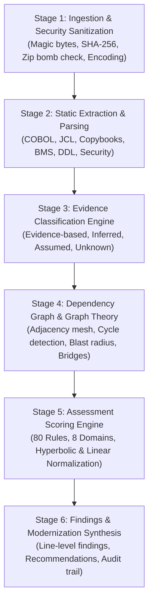

# ReFrameX Algorithmic Engine & Evidence Intelligence Architecture

> **Document Purpose:** Complete, line-level technical report on internal pipeline execution, parsing heuristics, evidence classification algorithms, graph theory computations, and mathematical scoring normalization inside ReFrameX.

---

## 1. High-Level Architectural Pipeline

From the microsecond an artifact (or ZIP archive) is uploaded into ReFrameX, the system initiates a 6-stage deterministic pipeline:



---

## 2. Stage 1: Ingestion, Security Sanitization & Preprocessing

### 2.1 Security & Ingestion Safeguards (`artifact_service.py`)
1. **Path Traversal Protection:** Every uploaded filename is sanitized using `Path(fname).name` to prevent directory traversal exploits (`../../etc/passwd`).
2. **Zip Bomb Prevention:**
   * Decompression ratio cap: Enforces a strict maximum expansion ratio of `100:1`.
   * Uncompressed payload cap: Enforces a hard ceiling of `100 MB` total uncompressed volume.
3. **Cryptographic Identity & Deduplication:**
   * Computes the SHA-256 digest: `hashlib.sha256(content).hexdigest()`.
   * Artifacts are stored immutably in read-only format on disk under UUID prefixes (`backend/app/uploads/{app_id}/{artifact_uuid}`).

### 2.2 Encoding Sniffing (`classifier.py::_detect_encoding`)
Before parsing, the byte stream is sniffed to distinguish mainframe character encodings:
* If `b"\x00"` exists $\rightarrow$ Classified as `binary`.
* Attempts `UTF-8` decode. If successful, attempts strict `ASCII` decode.
* If decode fails $\rightarrow$ Flags as `likely EBCDIC cp037` or binary data.

### 2.3 Artifact Classification (`classifier.py`)
Classification operates via a two-tier strategy:
1. **File Extension Map:** Maps 30+ extensions (`.cbl`, `.cpy`, `.jcl`, `.bms`, `.sql`, `.asm`, `.racf`, etc.) to specific categories (`COBOL`, `JCL`, `Copybook`, `BMS`, `SQL`, `HLASM`, `Security`) and capability levels:
   * `SUPPORTED_PARSE`: Full static extraction.
   * `DETECT_ONLY`: Detected for metadata and non-code governance.
   * `UNSUPPORTED`: Lowers assessment confidence.
2. **Content Signature Fallback:** If an extension is generic (e.g. `.txt`), case-insensitive substring sniffing searches for structural keywords:
   * `IDENTIFICATION DIVISION` $\rightarrow$ COBOL
   * `//JOB` or `//EXEC` $\rightarrow$ JCL
   * `DFHMSD` or `DFHMDI` $\rightarrow$ BMS Map
   * `DEFINE CLUSTER` $\rightarrow$ VSAM
   * `CREATE TABLE` $\rightarrow$ SQL

### 2.4 Lexical Preprocessing (`preprocessor.py`)
Mainframe source code relies on rigid columnar layouts. The preprocessor normalizes code into `PreprocessedLine` objects while preserving the **1-indexed original source line number**:
* **Fixed-Format COBOL Decomposition:**
  * **Columns 1–6:** Sequence Number Area (stripped/ignored).
  * **Column 7:** Indicator Area:
    * `*` or `/`: Flagged as comment (`is_comment = True`).
    * `D`: Debugging line (ignored in standard run).
    * `-`: **Continuation Line**. De-continued text is concatenated into the prior line's statement while tracking continuation status.
  * **Columns 8–11 (Area A):** Division, Section, Paragraph names, and Level 01/77 records.
  * **Columns 12–72 (Area B):** Executable statements and clauses.
  * **Columns 73–80:** Program Identification Area (truncated and discarded).
* **Free-Format Handling:** Automatically switches modes if `>>SOURCE FORMAT FREE` is encountered in the first 50 lines.

---

## 3. Stage 2: Parser Execution & Static AST Extraction

Parsers inherit from `BaseParser` and register via `@register_parser("category")`:

### 3.1 COBOL Parser (`cobol_parser.py`)
Extracts normalized structural components using specialized regex scanning machines:
* **Program ID & Division Bounds:** Locates `PROGRAM-ID. <NAME>` and partitions line intervals for `ENVIRONMENT`, `DATA`, and `PROCEDURE` divisions.
* **Control Flow & Anti-Patterns:**
  * **GOTO Detection (`_extract_goto`):** Scans for `\bGO\s+TO\b`. Emits `CONTROL_FLOW` component with `legacy_indicator: "GOTO"`. Records exact source line and snippet.
  * **PERFORM Nesting Depth (`_extract_performs`):** Builds a lexical stack of inline `PERFORM` and `END-PERFORM` statements. If stack depth $\ge 4$, flags deeply nested control flow.
  * **ALTER Detection (`_extract_alter`):** Detects self-modifying code (`ALTER <P1> TO PROCEED TO <P2>`).
* **Data Structure Extraction:**
  * **Record Hierarchies:** Scans level numbers `01` through `49`, `66`, `77`, `88`.
  * **`REDEFINES` Clauses:** Detects overlapping memory definitions (`REDEFINES <FIELD>`).
  * **`OCCURS DEPENDING ON`:** Detects dynamic-length arrays.
  * **`COMP` / `COMP-3`:** Flags binary and packed-decimal numeric fields requiring specialized microservice translation.
  * **`COPY` Statements:** Extracts copybook dependencies (`COPY <NAME> [REPLACING...]`).
* **External Interfaces & Persistence:**
  * **Dynamic vs. Static Calls:**
    * Static: `CALL 'LITERAL'` $\rightarrow$ emits static `PROGRAM` component.
    * Dynamic: `CALL <IDENTIFIER>` $\rightarrow$ emits dynamic `PROGRAM` component with `call_type: "dynamic"` and evidence class `Inferred`.
  * **Embedded SQL (`EXEC SQL ... END-EXEC`):** Extracts SQL statements (`SELECT`, `INSERT`, `UPDATE`, `DELETE`, `CURSOR`, `CONNECT`) and referenced table names.
  * **Embedded CICS (`EXEC CICS ... END-EXEC`):** Extracts terminal and transaction commands (`RETURN TRANSID`, `READ FILE`, `SEND MAP`, `RECEIVE MAP`, `LINK PROGRAM`).

### 3.2 JCL Parser (`jcl_parser.py`)
* Extracts Job cards (`//JOBNAME JOB ...`).
* Parses Job steps (`//STEPNAME EXEC PGM=...` or `PROC=...`).
* Extracts condition code logic (`COND=(code,operator)`).
* Parses DD (Data Definition) cards:
  * Dataset Names (`DSN=...`)
  * Dispositions (`DISP=(STATUS,NORMAL,ABNORMAL)`)
  * Temporary Pass Datasets (prefixed with `&&`, e.g. `&&SORTED`)
  * Generation Data Groups (`GDG (+1)`, `GDG (0)`)

### 3.3 BMS Screen Parser (`bms_parser.py`)
* Parses Mapsets (`DFHMSD`) and Map screens (`DFHMDI`).
* Extracts terminal field coordinates (`POS=(row, col)`), length, and attributes (`ATTRB=(PROT, UNPROT, IC, BRT)`).

### 3.4 SQL DDL Parser (`sql_parser.py`)
* Extracts `CREATE TABLE`, `CREATE INDEX`, `CREATE PROCEDURE`, primary keys, and foreign keys.

### 3.5 Pluggable Registry Output
Every extracted component is assigned a **Deterministic Identifier**:
$$\text{ID} = \text{SHA256}(\text{app\_id} \parallel \text{artifact\_id} \parallel \text{type} \parallel \text{name} \parallel \text{line\_start} \parallel \text{line\_end})[:16]$$
This guarantees that re-analyzing an unchanged repository produces zero database churn.

---

## 4. Stage 3: The 4-Tier Evidence Classification Engine

ReFrameX guarantees that findings and dependencies are strictly classified according to verifiable proof:

```
┌────────────────────────────────────────────────────────────────────────┐
│                   4-TIER EVIDENCE CLASSIFICATION RULES                 │
├───────────────────┬────────────────────────────────────────────────────┤
│ 1. Evidence-Based │ Explicitly observed in parsed code with start line,│
│                   │ end line, and code snippet.                        │
├───────────────────┼────────────────────────────────────────────────────┤
│ 2. Inferred       │ Contextually deduced from secondary runtime        │
│                   │ indicators (e.g. Dynamic CALL target resolved via  │
│                   │ prior MOVE literal assignment).                    │
├───────────────────┼────────────────────────────────────────────────────┤
│ 3. Assumed        │ Default enterprise operational assumption applied  │
│                   │ when non-code artifacts are absent (e.g. standard  │
│                   │ batch window assumption).                          │
├───────────────────┼────────────────────────────────────────────────────┤
│ 4. Unknown / Gap  │ Explicitly missing artifact or unresolvable call   │
│                   │ target (triggers confidence penalty).              │
└───────────────────┴────────────────────────────────────────────────────┘
```

### Unresolved Placeholder Engine (`_find_or_create_placeholder`)
When code references a component not present in the uploaded portfolio (e.g., `CALL 'SUB99'` or `COPY NONEXIST` where `NONEXIST.cpy` was not uploaded):
1. The engine **never crashes and never ignores the missing reference**.
2. It generates an explicit **Placeholder Component** with `evidence_class = "Unknown"`.
3. It creates an evidence reference:
   ```json
   {
     "rule": "UNRESOLVED_TARGET",
     "snippet": "Referenced as NONEXIST but no source artifact found"
   }
   ```
4. This unknown component lowers Assessment Confidence and surfaces inside the **Unknowns & Risks Registry**.

---

## 5. Stage 4: Dependency Graph & Graph Theory Algorithms

All components and references are assembled into a directed multi-graph $G = (V, E)$, where $V$ represents components and $E$ represents typed dependency edges (`CALL`, `COPY`, `EXEC_SQL`, `JCL_EXEC`, `DD_DSN`).

### 5.1 Adjacency Representation
```python
adj: dict[str, list[str]]         # Forward edges:  Source -> Targets
reverse_adj: dict[str, list[str]] # Backward edges: Target -> Sources
```

### 5.2 Cycle Detection Algorithm (`_find_circular_paths` & `_dfs_circular`)
Detects circular architectural coupling (e.g., $A \rightarrow B \rightarrow C \rightarrow A$):
* **Algorithm:** Depth-First Search (DFS) with path backtracking up to a search depth of 10.
* **Mechanism:**
  1. Maintains a `visited` set and a current traversal `path` stack.
  2. For each node, visits outgoing neighbors.
  3. If a neighbor matches the starting node and `len(path) >= 1`, a cycle is recorded.
  4. Circular paths are stored as evidence references, triggering rule **`CX-IX-004`** (+15 Complexity).

### 5.3 Blast Radius & Transitive Closure (`_bfs_set`)
To calculate the modernization impact radius:
* **Algorithm:** Breadth-First Search (BFS) graph traversal.
* **Computations:**
  * **Direct Downstream:** Immediate targets called by this component.
  * **Indirect Downstream (Blast Radius):** Full transitive reachable set:
    $$\text{Reachable}(u) = \{ v \in V \mid u \rightsquigarrow v \}$$
  * **Indirect Upstream:** All components that depend on this node.
  * If indirect downstream exceeds 20 nodes, the system flags **High Blast Radius**.

### 5.4 Single Point of Failure / Bridge Node Detection (`_is_single_point`)
Determines if a component acts as an architectural bottleneck:
* **Algorithm:** Bipartite connectivity check:
  1. Computes upstream caller set $U = \text{BFS}_{\text{reverse}}(u)$.
  2. Computes downstream dependency set $D = \text{BFS}_{\text{forward}}(u)$.
  3. Evaluates if removing node $u$ completely disconnects $U$ from $D$:
     $$\forall x \in U, \forall y \in D : \text{Paths}(x \rightarrow y) \text{ must pass through } u$$
  4. If true, flags node $u$ as a **Single Point of Dependency**, firing rule **`CX-IX-005`**.

---

## 6. Stage 5: Assessment Scoring Engine & Mathematical Normalization

The assessment engine evaluates **40 declarative rules** across **8 official domains** and **3 independent measures**.

### 6.1 The Cardinal Axiom of Evidence
> **"Missing evidence is NEVER evidence of simplicity."**
If an application is missing JCL or copybooks:
* Complexity score does **NOT** drop to zero.
* The unevidenced domain is excluded from complexity aggregation.
* The Assessment Confidence score is heavily penalized.
* Missing information is registered as a gap.

### 6.2 Measure Independence
The three measures are computed using distinct rule subsets and separate mathematical functions:
* **Migration Complexity (34 Rules):** Evaluates technical difficulty, coupling, anti-patterns, and legacy constructs.
* **Assessment Confidence (23 Rules):** Evaluates artifact completeness, parser coverage, and unresolved references.
* **Migration Readiness (23 Rules):** Evaluates documentation, ownership, test assets, and operational stability.

### 6.3 Mathematical Normalization Functions

#### A. Migration Complexity (Hyperbolic Saturation)
Raw complexity points accumulate additively from fired rules. To prevent runaway scores on large applications, raw scores are normalized via a hyperbolic saturation function:

$$S_{\text{domain}} = 100 \times \left( \frac{\text{raw}}{\text{raw} + K} \right), \quad K = 20.0$$

* If $\text{raw} = 0 \rightarrow S = 0.0$.
* If $\text{raw} = 20 \rightarrow S = 50.0$.
* As $\text{raw} \to \infty \rightarrow S \to 100.0$ asymptotically.

#### B. Assessment Confidence (Linear Baseline Clamp)
Confidence starts at a non-inflated baseline of 0.0 (Ruleset v2). Verified evidence adds points up to 100 per domain; missing artifacts and unknown references subtract points:

$$C_{\text{domain}} = \text{clamp}(0.0 + \text{raw}, \, 0.0, \, 100.0)$$

Confidence is further capped by overall evidence coverage ratio: $C \le \text{coverage\_ratio} \times 100.0$.

#### C. Migration Readiness (Linear Baseline Clamp)
Readiness evaluates organizational and architectural posture starting at baseline 0.0:

$$R_{\text{domain}} = \text{clamp}(0.0 + \text{raw}, \, 0.0, \, 100.0)$$

### 6.4 Portfolio Weighted Aggregation
Domain scores are aggregated using domain weights defined in `default_ruleset_v2.json`:

$$\text{Final Complexity} = \frac{\sum_{d \in D_{\text{evidenced}}} W_d \cdot S_d}{\sum_{d \in D_{\text{evidenced}}} W_d}$$

* **Dynamic Renormalization:** Only domains that have evidence contribute to the complexity score. Weights are automatically renormalized across evidenced domains, guaranteeing that unevidenced domains do not dilute complexity. Confidence and readiness aggregate over all 8 domains (unevidenced = 0.0).

---

## 7. Stage 6: Findings, Recommendations & Human Review Synthesis

1. **Rule Firings to Material Findings:**
   Every rule firing generates a `Finding` record containing:
   * Rule ID (e.g. `CX-AB-002`)
   * Severity (`Critical`, `High`, `Medium`, `Low`)
   * Evidence Classification (`Evidence-based`, `Inferred`, `Assumed`, `Unknown`)
   * Exact Line Range and Source Snippet
2. **Prioritized Recommendations:**
   Findings automatically generate modernization recommendations linked to OpenShift target patterns (e.g., refactoring CICS BMS screens to React SPAs, containerizing JCL batch to Tekton pipelines).
3. **Immutable Human Governance:**
   Architect overrides and review actions are stored in an independent `review_actions` database table. The underlying parsed evidence remains completely immutable for compliance auditing.

---

## 8. Summary Table: From Artifact to Score

| Step | Component | Input | Output | Exact Algorithm / Formula |
|:---:|:---|:---|:---|:---|
| **1** | Sniffer & Preprocessor | Raw File Bytes | `PreprocessedLine[]` | Sequence stripping, column-7 indicator parsing, continuation de-aliasing. |
| **2** | Pluggable Parsers | `PreprocessedLine[]` | `NormalizedComponent[]` | Regex AST scanners for COBOL, JCL, BMS, SQL, RACF. Deterministic SHA-256 IDs. |
| **3** | Evidence Classifier | Extracted Components | Classified Findings | Categorization into Evidence-based, Inferred, Assumed, or Unknown placeholder. |
| **4** | Dependency Engine | Components & Artifacts | Directed Graph $G=(V,E)$ | Tarjan SCC for linear-time cycles; BFS transitive closure for blast radius; dominance choke point check. |
| **5** | Scoring Normalization | Fired Rules (80 rules) | 3 Independent Scores | Hyperbolic $100 \times \frac{\text{raw}}{\text{raw}+20}$ (Complexity); Linear $0.0 + \text{raw}$ (Confidence & Readiness). |
| **6** | Governance Synthesis | Assessment Result | 19-Section Report | Dynamic weight renormalization, recommendation synthesis, and immutable audit logging. |
